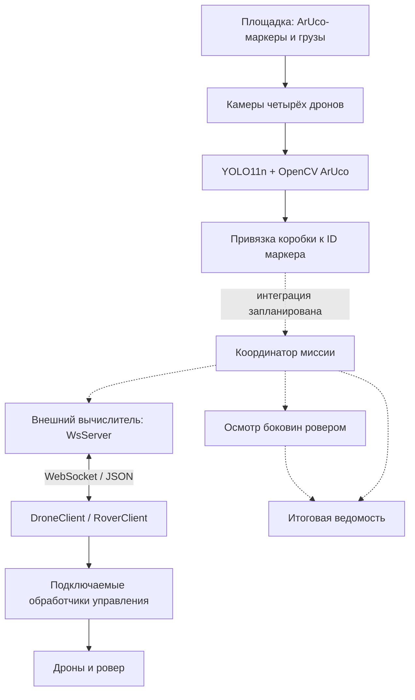

# Автоматическая инвентаризация открытой площадки хранения

**Хайтек: Навыки будущего — 2026**

Компетенция: «Технологии ИИ в комплексных беспилотных системах»

> Установка зависимостей
> ```bash
> python -m pip install -r requirements.txt
> ```

## 1. О проекте

**Цель проекта:** разработать автономную систему инвентаризации открытой площадки хранения с использованием группы из 2–4 беспилотных летательных аппаратов и наземного ровера.

Дроны выполняют осмотр мест хранения сверху, определяют их состояние и передают информацию об аномальных или неоднозначных местах роверу для дополнительной проверки.

Результатом работы системы является единая ведомость фактического наличия грузов.

### Основные задачи

- Создание датасета, по которому нейросеть обучится различать коробки и определять аномалии.
- Обучить нейросеть YOLO и загрузить её на платы дронов.
- Составить полётный план для 4 дронов и запрограммировать их.
- Создать алгоритм, который будет выполнять ровер для исследования аномальных мест.
- Создать программу для внешнего вычислителя, который будет являться и координатором миссии, и генератором ведомости.

## 2. Описание конкурсного кейса

На площадке хранения размещены ArUco-маркеры, каждый из которых обозначает определённое место хранения.

Система должна автоматически определять состояние каждого места:

| Состояние | Описание |
|---|---|
| Занято | На месте находится груз |
| Пусто | Груз отсутствует |
| Аномальное | Обнаружен посторонний предмет или повреждение груза |

### Особенности выполнения

- Осмотр выполняется группой из 4 дронов.
- Камеры дронов направлены вниз.
- Камера ровера направлена вперёд для осмотра боковых поверхностей.
- Аномальные места дополнительно проверяются ровером.
- Решение ровера является окончательным.
- Все аппараты работают автономно.
- Итоговая ведомость объединяет результаты всех вылетов одной попытки.

## 3. Архитектура системы

### 3.1. Общая архитектура

- [drone](drone/README.md) — полёт по ArUco-карте, съёмка и обработка кадров на дроне.
- [rover](rover/rover_client.py) — клиент команд наземного робота.
- [shared](shared/ws_server.py) — WebSocket-связь и привязка коробок к маркерам.
- [simulation](simulation/README.md) — ранний прототип полёта четырёх дронов в MuJoCo.
- [YOLO](YOLO/train/High_Tech_MEPHI.ipynb) — обучение, веса и скрипты компьютерного зрения.

Состояние реализации описано по файлам репозитория на 10.11.2026. Реализованы отдельные модули; полный автономный цикл ещё требует интеграции.



Пунктиром показаны связи, которые ещё не объединены в работающую миссию.

### 3.2. Основные компоненты

| Компонент | Назначение | Реализация |
|---|---|---|
| Группа дронов | Полёт, съёмка, обнаружение коробок и ArUco | `drone/aruco_nav/flight_aruco.py`, `drone/prepare_dataset/`, `drone/aruco_det/match.py`; общий маршрут четырёх реальных дронов ещё не реализован |
| Наземный ровер | Дополнительная проверка мест хранения | `rover/rover_client.py`: диспетчер команд `navigate` и `stop`; обработчики движения и осмотра подключаются отдельно |
| Компьютерное зрение | Детекция коробок и привязка к месту | YOLO11n, OpenCV ArUco, `shared/match_box.py`; классификация повреждений пока не реализована |
| Координатор миссии | Распределение маршрутов и очереди осмотра | Основа связи — `shared/ws_server.py`; планировщика миссии в репозитории пока нет |
| Модуль связи | Команды и ответы аппаратов | `shared/ws_server.py`, `shared/ws_client.py`, библиотека `websockets` |
| Генератор ведомости | Объединение результатов одной попытки | Форматы описаны в `YOLO/README_YOLO_baseline.md`; исполняемого генератора в текущем дереве нет |

### 3.3. Разделение программного обеспечения

| Программное обеспечение | Источник | Назначение |
|---|---|---|
| ПО «Сверх», `sverk_interfaces` | ПО производителя | Управление дроном, получение телеметрии и изображений; среда оборудования на ROS 2 |
| `drone/`, `rover/`, `shared/`, `simulation/`, скрипты и ноутбуки `YOLO/` | Разработано командой | Полётный пример, сбор датасета, обучение модели, обработка изображений, обмен командами, симуляция |
| Ultralytics, OpenCV, NumPy, websockets, MuJoCo | Сторонние библиотеки | Нейросетевая детекция, ArUco и обработка кадров, вычисления, связь и моделирование |

## 4. Алгоритм выполнения миссии

Ниже приведён целевой сценарий. У каждого незавершённого этапа указано, чего ещё нет в текущей реализации.

### Этап 1. Инициализация

Оператор подготавливает площадку и калибрует аппараты, загружает ArUco-карту на дроны, проверяет телеметрию, камеру и связь. Для предварительной отработки движения предусмотрена симуляция. Перед полётом необходимо согласовать словарь ArUco и положение начала координат с реальной разметкой.

### Этап 2. Распределение задач

Площадка делится на зоны осмотра четырёх дронов с перекрытием кадров, позволяющим сопоставлять наблюдения одних и тех же маркеров. Координатор должен учитывать занятые зоны и выдавать маршруты. Автоматического распределения задач в текущем коде нет.

### Этап 3. Воздушная инвентаризация

Дроны локализуются по известной ArUco-карте и снимают места хранения сверху. Реальный полётный пример `flight_aruco.py` выполняет взлёт до 2 м в `map`, переход к `(2, 2, 2)` в `aruco_map` со скоростью 0,3 м/с и посадку. Это проверка навигации одного дрона; обход рядов всей группой ещё предстоит подключить.

### Этап 4. Обработка результатов

YOLO11n находит рамки коробок, OpenCV — центры ArUco-маркеров. Функция `match_box_to_marker()` ищет подходящую метку слева от коробки, а `scan()` возвращает список `marker_id` и `box_center`. Сейчас результат выводится в консоль. Передача наблюдений координатору и определение состояний «пусто»/«аномалия» ещё не подключены.

### Этап 5. Передача заданий роверу

В целевом сценарии вычислитель формирует очередь неоднозначных или аномальных мест, по ID находит координаты в карте и выбирает точку осмотра рядом с грузом. Имеющийся `RoverClient` принимает команды `navigate` и `stop`, но построение очереди, точки подъезда и преобразование координат пока не реализованы.

### Этап 6. Наземная проверка

Ровер должен подъехать к выбранному месту, остановиться перед съёмкой, получить изображение боковой поверхности и передать окончательное решение вместе с ID места. Нужны обработчик движения, доступ к камере и модель либо алгоритм оценки повреждений. В текущем репозитории есть только клиент команд; автономная проверка ровером ещё не реализована.

### Этап 7. Формирование ведомости

Проектный принцип объединения — одна строка на ID ArUco в пределах одной попытки. Повторные наблюдения дронов относятся к той же строке; подтверждённое решение ровера имеет приоритет. Неосмотренные и неоднозначные места должны сохраняться отдельно от подтверждённо пустых. Предусмотрены `observations.jsonl`, `inventory.csv` и `rover_queue.json`, но код их формирования пока отсутствует.

### Этап 8. Завершение миссии

Целевое условие завершения: все запланированные места учтены, очередь проверок обработана либо оставшиеся места помечены как неопределённые, результаты сохранены. Затем дроны садятся, ровер останавливается, соединения закрываются. В полётном примере вызов `land()` находится в том числе в блоке `finally`; общего контроллера завершения миссии пока нет.

**Обработка нештатных ситуаций:**

- Полётный пример проверяет `connected` и `armed`, задаёт таймауты перемещения 30 и 60 секунд и вызывает посадку при выходе из `try`.
- При отсутствии кадра скрипт периодической съёмки сообщает об ошибке и переходит к следующему циклу. При невозможности привязать коробку к метке `scan()` возвращает `marker_id: null`.
- Клиент связи возвращает `ok: false` и текст исключения при ошибке выполнения команды. Переподключение, повтор команд и автоматические действия при разрыве связи пока не реализованы.
- Контроль низкого заряда, потери локализации и конфликтов маршрутов должен быть добавлен в координатор и бортовые обработчики. Текущий код не задаёт пороги заряда и не подтверждает наличие таких защит в настройках автопилота.

## 5. Взаимодействие аппаратов

### 5.1. Организация связи

**Используемый протокол:** WebSocket; команды и ответы передаются текстовыми JSON-сообщениями. Сервер по умолчанию слушает `0.0.0.0:8000`.

**Технология передачи данных:** IP-сеть между внешним вычислителем и аппаратами. Транспорт реализован библиотекой `websockets`; тип физического подключения в коде не закреплён.

**Передаваемая информация:**

- При регистрации — уникальный строковый ID аппарата, затем ответ сервера `ok`.
- От сервера — имя команды и словарь именованных параметров: дрону `navigate`/`land`, роверу `navigate`/`stop`.
- От аппарата — результат обработчика в поле `data` либо текст ошибки в `error`. Передача изображений, телеметрии и наблюдений отдельными типами сообщений пока не реализована.

### 5.2. Формат сообщений

Первое сообщение клиента — обычная строка, например `drone-1`; подтверждение регистрации — обычная строка `ok`. Далее используется JSON.

Команда посадки дрону:

```json
{"command": "land", "params": {}}
```

Команда остановки роверу:

```json
{"command": "stop", "params": {}}
```

Пример команды перемещения при подключённом обработчике с соответствующими аргументами:

```json
{"command": "navigate", "params": {"x": 2.0, "y": 2.0, "z": 2.0, "frame_id": "aruco_map", "speed": 0.3}}
```

`WsClient` вызывает `await handler(**params)`, поэтому обработчики должны быть асинхронными, а допустимые параметры определяются их сигнатурами. Для синхронных вызовов `sverk_interfaces` нужен отдельный адаптер. Параметры дрона нельзя автоматически переносить на ровер.

Успешный ответ, если обработчик не возвращает значение:

```json
{"ok": true, "data": null}
```

Пример ответа при исключении в обработчике:

```json
{"ok": false, "error": "Нет связи с контроллером"}
```

Результат локальной функции `scan()` имеет следующую структуру; сейчас он **не отправляется по WebSocket**:

```json
[{"marker_id": 122, "box_center": [320, 240]}, {"marker_id": null, "box_center": [510, 200]}]
```

`box_center` — координаты центра рамки в пикселях, не координаты груза на площадке.

### 5.3. Обработка ошибок связи

Сервер ждёт ID при регистрации до 5 секунд. Пустой, нетекстовый или уже подключённый ID отклоняется с кодом закрытия `1008`. После отключения запись клиента удаляется. Для каждого аппарата `asyncio.Lock` допускает только один одновременно ожидающий ответа запрос `transmit()`.

Ответ `ok: true/false` отражает завершение обработчика команды; отдельных подтверждений приёма, номеров запросов и защиты от повторного выполнения нет. Таймаут ожидания ответа в `transmit()`, автоматическая повторная отправка, переподключение клиента и аварийная остановка при обрыве связи не реализованы. Ошибка транспорта передаётся вызывающему коду.

## 6. Системы координат и преобразования

### 6.1. Используемые системы координат

| Система координат | Начало отсчёта | Единицы измерения | Назначение |
|---|---|---|---|
| Дрона: `map` | Задаётся бортовой системой локализации; положение относительно площадки в репозитории не зафиксировано | Метры; углы в командах — радианы | Взлёт и получение телеметрии |
| Дрона: `aruco_map` | Центр поля согласно файлу ArUco-карты | Метры | Перемещение к точкам известной сетки маркеров |
| Ровера | Локальная система должна быть сопоставлена с системой ArUco map | Должны быть согласованы с обработчиком; для общей карты используются метры | Наземная навигация после интеграции |
| Общая карта площадки | Центр прямоугольника 7,5 × 4,5 м; маркеры лежат в плоскости `z = 0` | Метры | Общий адрес места по ID 100–144 и координатам маркера |
| Изображение | Левый верхний угол кадра, `x` вправо, `y` вниз | Пиксели | Детекция и сопоставление коробки с маркером |

В [карте](drone/aruco_nav/aruco_map_750x450_id100.txt) 45 маркеров: 9 столбцов × 5 рядов, сторона метки 0,25 м, шаг центров 0,75 м. ID растут по строкам от нижнего левого угла к верхнему правому; маркер 122 находится в центре.

### 6.2. Метод пересчёта координат

Текущая привязка работает в плоскости изображения: по взаимному расположению рамки и метки выбирается ID. Она не переводит пиксели в метры и не выполняет преобразование между дроном и ровером.

Координаты маркера из регулярной карты можно получить по ID:

```text
i = marker_id - 100,  0 <= i <= 44
column = i % 9
row = i // 9
x_map = -3.00 + 0.75 * column
y_map = -1.50 + 0.75 * row
z_map = 0
```

Это координаты центра маркера. Точку осмотра ровера необходимо выбирать отдельно, с учётом положения коробки и свободного пространства.

Для будущей интеграции двух плоских метрических систем используется поворот и перенос:

```text
x_map = cos(theta) * x_rover - sin(theta) * y_rover + tx
y_map = sin(theta) * x_rover + cos(theta) * y_rover + ty

x_rover =  cos(theta) * (x_map - tx) + sin(theta) * (y_map - ty)
y_rover = -sin(theta) * (x_map - tx) + cos(theta) * (y_map - ty)
```

`theta` — поворот осей ровера относительно карты, `(tx, ty)` — положение его начала координат в карте. Эти параметры необходимо определить по соответствующим контрольным точкам на площадке; их значений и реализации преобразования в репозитории пока нет. Формулы предполагают одинаковый масштаб и согласованное направление осей.

### 6.3. Проверка на площадке
[TODO]
Полевые замеры пересчёта в систему ровера не сохранены. Ниже — проверка формулы ID → координаты по файлу карты, а не результат навигационного испытания:

| Контрольная точка | Координаты из карты, м | Координаты по формуле, м | Расхождение с файлом, м |
|---|---|---|---|
| ArUco 100 | (−3,00; −1,50; 0) | (−3,00; −1,50; 0) | 0 |
| ArUco 122 | (0; 0; 0) | (0; 0; 0) | 0 |
| ArUco 144 | (3,00; 1,50; 0) | (3,00; 1,50; 0) | 0 |

**Вывод:** формула соответствует сетке в файле. Точность локализации и подъезда ровера по этим данным оценить нельзя. При испытаниях следует измерить фактические координаты нескольких точек и вычислить ошибку `sqrt((x_calc - x_ref)^2 + (y_calc - y_ref)^2)` в метрах.

## 7. Компьютерное зрение

### 7.1. Метод распознавания

Используется детектор YOLO11n, дообученный на собственных фотографиях коробок. Веса и сохранённые журналы обучения содержат один класс `box_hitech`. Модель возвращает рамки и уверенность; она пока не различает исправные коробки, повреждения и посторонние предметы.

OpenCV обнаруживает ArUco, после чего `match_box_to_marker()` выбирает ближайшую подходящую метку слева от рамки: её центр должен попадать в диапазон высоты коробки, а горизонтальный зазор — не превышать `0.9 × ширина коробки`. Поддерживается угол поворота, но текущие вызывающие скрипты передают `angle_deg=0`. Если подходящей метки нет, возвращается `None`.

Трёхклассовая схема `box_ok`, `box_damaged`, `foreign_object` из `YOLO/data.yaml` относится к исходному замыслу. Она не соответствует текущим одноклассовым весам и не должна использоваться для их оценки без исправления конфигурации.

### 7.2. Характеристики модели

| Параметр | Значение |
|---|---|
| Название модели | YOLO11n, базовое обучение и последующее дообучение |
| Архитектура | Одностадийный детектор; сохранённая сводка после объединения слоёв: 101 слой, 2 597 051 параметр, 6,4 GFLOPs |
| Версия | Ultralytics 8.4.208 в журналах обучения и метаданных весов |
| Распознаваемые классы | `0: box_hitech` — коробка |
| Размер обучающей выборки | Базовая: 78 train / 17 val / 16 test; дополнительная: 120 / 25 / 27; дообучение: 198 train и 42 val |
| Размер входного изображения | `imgsz=640` при обучении; в сохранённом примере инференса тензор 480 × 640 с сохранением пропорций |
| Порог уверенности | `detect.py`: `--conf 0.25`; в `match.py` и `mathc_aruco_box.py` явно не задан; `confidence=0.65` из `YOLO/config.json` этими скриптами не читается |
| Место выполнения вычислений | Обучение — Google Colab, NVIDIA Tesla T4; скрипты детекции используют CPU, бортовой вариант получает кадры через `sverk_interfaces` |
| Базовые веса | `YOLO/weights/best_drone_photos_yolo.pt` |
| Дообученные веса | `YOLO/YOLO11n_models/YOLO11n_finetune/best_for_finetune.pt` |

Для базового обучения заданы 100 эпох, batch 8, patience 20, seed 42; журнал содержит 75 эпох. Для дообучения заданы 50 эпох, batch 8, AdamW, `lr0=0.001`, patience 15, seed 42; сохранённый журнал заканчивается на 32-й эпохе.

### 7.3. Подготовка данных

**Источники изображений:** собственные фотографии с камер дронов и дополнительные фотографии коробок с других устройств. Одиночный снимок сохраняется скриптом `take_picture.py` в `photos/` текущего каталога; `continuous_take_pictures.py` снимает каждые 15 секунд в `~/photos/`.

**Разметка данных:** прямоугольные рамки в формате YOLO — `class_id center_x center_y width height`, координаты нормализованы к ширине и высоте изображения. Текущий класс — `0: box_hitech`. Файлы изображений и разметки имеют одинаковые имена без расширения и распределены по `images/{train,val,test}` и `labels/{train,val,test}`. Ноутбуки читают классы из `classes.txt` и создают YAML для конкретного датасета.

В журналах сохранены архивы-источники `YOLO.zip` и `extra_training_dataset_drones.zip` из Google Drive. Всего в двух наборах 283 изображения: 198 train, 42 val и 43 test. В итоговом `combined.yaml` ноутбука дообучения объединены только train и val; общей оценки 43 тестовых кадров в нём нет. Сами архивы в репозиторий не включены.

**Предобработка и аугментации:** изменение размера с `imgsz=640`; по сохранённой конфигурации обучения используются HSV-вариации (`hsv_h=0.015`, `hsv_s=0.7`, `hsv_v=0.4`), горизонтальное отражение (`fliplr=0.5`), сдвиг (`translate=0.1`), масштабирование (`scale=0.5`) и mosaic (`mosaic=1.0`, отключение за 10 последних эпох). Отдельный эксперимент `YOLO/HSV_filter/hsv_script.py` выделяет синий диапазон HSV `[90,100,40]–[110,255,255]` и применяет морфологическое открытие/закрытие ядром 3 × 3. Он не включён в текущий вызов YOLO.

## 8. Метрики качества распознавания

### 8.1. Сохранённые результаты валидации

[TODO]
Значения ниже взяты из финальной проверки лучших весов в ноутбуках. Это валидация детекции коробок, а не метрики законченной инвентаризации и не отдельное сравнение дрона с ровером.

| Метрика | Базовая модель | Дообученная модель |
|---|---|---|
| Кадры валидации / размеченные объекты | 17 / 43 | 42 / 131 |
| Precision | 0,997 | 0,992 |
| Recall | 1,000 | 0,969 |
| F1 = 2PR / (P + R) | ≈ 0,9985 | ≈ 0,9804 |
| mAP@0.50 | 0,995 | 0,992 |
| mAP@0.50:0.95 | 0,654 | 0,536 |

F1 рассчитан по округлённым Precision и Recall из журналов. Выборки различаются, поэтому сравнение этих чисел само по себе не доказывает улучшение или ухудшение на одинаковых условиях.

Отдельные полевые Accuracy, Precision, Recall, F1 для дронов и ровера не зафиксированы. Доля ложных аномальных отметок в материалах не зафиксирована: текущая модель не выделяет класс аномалий. Accuracy итоговой ведомости можно измерить только после появления решений по каждому месту и эталонной ведомости площадки.

### 8.2. Тестовые изображения и методика

**Расположение материалов:**

- [YOLO/assets](YOLO/assets/) — четыре исходных примера для сопоставления коробок и меток (`test_match_1.png`, `test_mathc_2.png`, `test_match_3.jpg`, `test_match_4.jpg`) и изображение результата.
- [drone/prepare_dataset/assets/example.jpg](drone/prepare_dataset/assets/example.jpg) — пример кадра с дрона.
- [YOLO/train/training_info](YOLO/train/training_info/) — CSV обучения, кривые метрик, матрицы ошибок и примеры валидации базовой модели.
- Исходные test-разбиения находятся в архивах датасетов. В базовом ноутбуке сохранён прогон детекции по 16 тестовым кадрам, но отдельный отчёт `val(split="test")` не представлен.

**Методика проверки:** выделить независимые кадры с площадки для верхнего и бокового ракурсов, вручную проверить рамки и ID мест. Для детектора измерить Precision, Recall и mAP на test-разбиении с правильным одноклассовым YAML. Для всей системы отдельно оценить долю верных привязок к ArUco и совпадение статусов с эталонной ведомостью. После реализации аномалий считать ложные тревоги как число исправных мест, ошибочно помеченных аномальными, делённое на число исправных мест. Порог уверенности и правила сопоставления фиксировать до оценки test-набора.

**Вывод:** на сохранённых валидационных наборах детектор находит коробки с высокими Precision и Recall. Полнота осмотра, распознавание повреждений, качество наземной проверки и точность конечной ведомости этими результатами не подтверждаются.

## 9. Используемые технологии

### 9.1. Программное обеспечение

Версии окружения проекта приведены по локальному `.venv`, обучения — по сохранённым ноутбукам. Ограничения для установки находятся в `requirements.txt`.
[TODO]
| Технология | Версия | Назначение |
|---|---|---|
| Python | 3.14.4 в локальном окружении; 3.13.16 при обучении в Colab | Скрипты управления, обработки и обучения |
| ROS 2 | Humble, согласно описанию команды | Среда работы оборудования «Сверх» |
| ROS 2 | Jazzy, согласно описанию команды | Среда работы оборудования «Сверх» |
| QGroundControl | 5.0.8, согласно описанию команды | Калибровка дронов |
| balenaEtcher | 2.1.9, согласно описанию команды | Запись образов для бортовых компьютеров |
| Ultralytics | 8.4.208; в зависимостях `>=8.3,<9` | YOLO11n, обучение и детекция |
| OpenCV contrib | 4.14.0.94; в зависимостях `>=4.10,<5` | ArUco, чтение и обработка изображений |
| NumPy | 2.5.4; в зависимостях `>=1.26,<3` | Геометрические вычисления |
| websockets | 17.4 локально; в зависимостях версия не закреплена | Асинхронный обмен командами |
| MuJoCo | 4.0.0 | Симуляция поля и полёта |
| PyTorch | 2.14.1+cu130 в журнале Colab | Обучение YOLO на Tesla T4 |
| `sverk_interfaces` | -| Бортовое управление и доступ к камере |

### 9.2. Оборудование

| Оборудование | Модель | Количество | Назначение |
|---|---|---|---|
| Дрон | Обрик ROS 2 | 4 | Воздушный осмотр |
| Ровер | mecanum-rover-v1 | 1 | Наземная проверка |
| Внешний вычислитель | ROG STRIX G615 | Один сервер по архитектуре проекта | Координация, сбор результатов и формирование ведомости после интеграции |
| Ускоритель обучения | NVIDIA Tesla T4 в Google Colab | 1 в сохранённых запусках | Обучение и дообучение YOLO11n |
| Ускоритель обучения (2) | NVIDIA RTX 5060 laptop | 1 в сохранённых запусках | Обучение и дообучение YOLO11n |
[TODO] по поводу ноутбучной карты и количества использований
## 10. Структура репозитория

```text
.
├── README.md
├── requirements.txt
├── drone/
│   ├── drone_client.py
│   ├── aruco_nav/
│   │   ├── flight_aruco.py
│   │   └── aruco_map_750x450_id100.txt
│   ├── aruco_det/match.py
│   └── prepare_dataset/
│       ├── take_picture.py
│       ├── continuous_take_pictures.py
│       └── assets/
├── rover/
│   ├── README.md
│   └── rover_client.py
├── shared/
│   ├── ws_server.py
│   ├── ws_client.py
│   └── match_box.py
├── YOLO/
│   ├── README_YOLO_baseline.md
│   ├── data.yaml
│   ├── config.json
│   ├── train/
│   │   ├── High_Tech_MEPHI.ipynb
│   │   └── training_info/
│   ├── weights/best_drone_photos_yolo.pt
│   ├── YOLO11n_models/
│   │   ├── YOLO11n_baseline/
│   │   └── YOLO11n_finetune/
│   │       ├── best_for_finetune.pt
│   │       └── High_Tech_MEPHI_finetune.ipynb
│   ├── scripts/
│   │   ├── detect.py
│   │   └── mathc_aruco_box.py
│   ├── assets/
│   └── HSV_filter/
│       ├── hsv_script.py
│       └── processed_photos/
└── simulation/
    ├── logic/
    │   ├── grid/
    │   ├── simulation/
    │   └── vision/
    ├── scene/
    └── scripts/
        ├── generate_field.py
        ├── base_xy.py
        └── scan_field.py
```

`drone/` содержит бортовые примеры; `rover/` — интерфейс команд ровера; `shared/` — общую связь и геометрию. В `YOLO/` находятся обучение, веса и эксперименты с изображениями. `simulation/` хранит ранний независимый прототип поля и движения. Каталоги `dataset/`, `frames/`, `attempts/`, `runs/` и `.venv/` исключены из Git.

## 11. Установка и развёртывание

### 11.1. Системные требования

| Параметр | Требование |
|---|---|
| Операционная система | Для бортовых скриптов — образ производителя с `sverk_interfaces` и ROS 2; команды ниже рассчитаны на Linux и shell с `source` |
| Версия Python | Локальное окружение проекта — 3.14.4; обучение записано на 3.13.16. На борту нужен интерпретатор, для которого установлен SDK производителя |
| Версия ROS 2 | Humble в описании оборудования; для отдельного WebSocket-сервера и обработки сохранённых кадров ROS 2 не требуется |
| Дополнительные зависимости | `requirements.txt`; `sverk_interfaces` предоставляется отдельно средой производителя |
| Необходимое оборудование | Для сохранённых кадров — ПК; для бортовых скриптов — Обрик с камерой и настроенной локализацией; для полной миссии — четыре дрона, ровер, внешняя машина и общая сеть |

### 11.2. Установка проекта

```bash
git clone https://github.com/smifick/High_Tech_2026.git
cd High_Tech_2026
python3 -m venv .venv
source .venv/bin/activate
python -m pip install -r requirements.txt
```

На дроне используются Python и библиотеки из среды производителя. Установка `requirements.txt` сама по себе не устанавливает ROS 2 и `sverk_interfaces`.

### 11.3. Настройка конфигурации

1. На каждом дроне установить `drone/aruco_nav/aruco_map_750x450_id100.txt` в `~/sverk_ws/src/sverk_drone/odometry/aruco/aruco_map/config/` и выбрать эту карту в конфигурации производителя. После настройки перезапустить `sverk-ros2-docker.service` согласно [бортовому README](drone/README.md).
2. Согласовать словарь маркеров: в комментарии карты указан `DICT_4X4_1000`, а в детекторах и `YOLO/config.json` — `DICT_4X4_250`. Использовать словарь фактически напечатанных меток; его выбор должен быть одинаковым во всех компонентах.
3. Проверить координаты и высоту в `flight_aruco.py` для конкретной площадки. Скрипт содержит готовые команды реальному аппарату, включая `auto_arm=True`.
4. Для связи задать адрес внешнего сервера вида `ws://<IP-вычислителя>:8000`, уникальные `robot_id` и асинхронные обработчики при создании `DroneClient`/`RoverClient`. Отдельного файла конфигурации и готовых точек запуска клиентов нет.
5. Для обучения настроить пути к архивам в ноутбуках и YAML фактического датасета. `YOLO/data.yaml` пока содержит пример абсолютного пути и три проектных класса; для имеющихся весов нужен один класс `box_hitech`.
6. `detect.py` ищет веса рядом с собой в `YOLO/scripts/`, хотя базовые веса находятся в `YOLO/weights/`. Команда ниже использует корректный путь напрямую. Для запуска именно `detect.py` сначала исправить путь к весам либо скопировать их в ожидаемый каталог.
7. В `mathc_aruco_box.py` пути к изображению, модели и результату заданы абсолютно для `/data/Projects/High_Tech_2026`; при переносе проекта их нужно изменить. `drone/aruco_det/match.py` ожидает `./yolo.pt` в текущем каталоге.
8. `YOLO/config.json` содержит проектные ROI и пороги, но текущие скрипты их не читают. Изменение этого файла само по себе не меняет работу детектора.

### 11.4. Запуск доступных модулей

Команды выполняются из корня репозитория. Единой команды запуска полной миссии пока нет.

**Проверка YOLO на сохранённом изображении, на ПК:**

```bash
source .venv/bin/activate
python - <<'PY'
from ultralytics import YOLO

model = YOLO("YOLO/weights/best_drone_photos_yolo.pt")
model.predict(
    source="YOLO/assets/test_match_1.png",
    conf=0.25,
    imgsz=640,
    device="cpu",
    save=True,
    project="runs",
    name="readme_demo",
)
PY
```

Для проверки дообученной версии заменить путь на `YOLO/YOLO11n_models/YOLO11n_finetune/best_for_finetune.pt`.

**Сервер команд, на внешнем вычислителе:**

```bash
python -u -c 'from shared.ws_server import WsServer; WsServer(host="0.0.0.0", port=8000).run()'
```

Эта команда поднимает транспортный сервер. Она не выдаёт маршруты: прикладной координатор должен вызывать `transmit()` и обрабатывать ответы. Файлы `drone_client.py` и `rover_client.py` определяют классы, поэтому запуск этих файлов напрямую не подключит аппараты.

**Съёмка кадров, на дроне в среде производителя:**

```bash
python3 drone/prepare_dataset/continuous_take_pictures.py
```

**Проверочный полёт одного дрона после настройки площадки:**

```bash
python3 drone/aruco_nav/flight_aruco.py
```

**Бортовая детекция без запуска полёта:**

```bash
cp YOLO/YOLO11n_models/YOLO11n_finetune/best_for_finetune.pt yolo.pt
python3 -m drone.aruco_det.match
```

Скрипт печатает ID меток и центры коробок. Запускать его нужно в среде, где доступны и `sverk_interfaces`, и зависимости компьютерного зрения.

**Симуляция раннего прототипа, на ПК с графическим окружением:**

```bash
python -m simulation.scripts.generate_field --drones 4 --boxes 15 --seed 42
python -m simulation.scripts.base_xy
PYTHONPATH=.:simulation/logic python simulation/scripts/scan_field.py
```

Генератор перезаписывает сцену и `ground_truth.json` в `simulation/scene/`. Дополнительный `PYTHONPATH` нужен из-за импорта `grid.mapping` в `scan_field.py`. Этот сценарий использует собственную геометрию поля и не подтверждает работоспособность реального маршрута; в просмотре кадров ожидается нажатие клавиши.

### 11.5. Порядок выполнения миссии

1. Подготовить карту и аппараты, проверить камеру, связь, телеметрию и локализацию; отдельно выполнить пробу детекции на кадрах.
2. Проверить навигацию одного аппарата и подключение клиентов к серверу с реальными обработчиками команд.
3. После реализации координатора распределить маршруты, провести воздушный осмотр и передать места дополнительной проверки роверу.
4. После реализации наземного осмотра и генератора объединить результаты по ID, сохранить ведомость и завершить работу аппаратов.

Шаги 3–4 описывают целевую интеграцию; текущие отдельные скрипты не выполняют их автоматически.

### 11.6. Остановка системы

В полной системе сначала нужно дождаться посадки дронов и остановки ровера, затем закрывать сервер. Команды `land` и `stop` доступны через клиентов только при подключённых обработчиках.

Полётный пример вызывает `land()` и `drone.close()` в `finally`. Периодическая съёмка обрабатывает `Ctrl+C` и закрывает интерфейс дрона. Сервер останавливается через `Ctrl+C`; его остановка не отправляет аппаратам команды посадки или остановки. Для `match.py` отдельный блок завершения не реализован, поэтому завершение детекции нельзя считать остановкой аппарата.

### 11.7. Результаты работы

- **Итоговая ведомость:** в текущем коде не формируется. Проектное размещение из раннего описания — `attempts/001/inventory.csv`, журнал `attempts/001/observations.jsonl`, очередь `attempts/001/rover_queue.json`; это планируемые файлы.
- **Формат ведомости:** CSV, одна запись на ID места с состоянием и источником решения. Точный набор столбцов ещё не закреплён кодом.
- **Фактические изображения:** периодическая съёмка — `~/photos/`; одиночная — `photos/`; пример YOLO выше — `runs/readme_demo/` (при повторном запуске имя может получить числовой суффикс); `detect.py` — `YOLO/scripts/results/` после настройки пути весов.
- **Логи:** сетевые и бортовые скрипты выводят сообщения в stdout/stderr; общего файла журнала миссии нет. Сохранённый журнал базового обучения — `YOLO/train/training_info/results.csv`, полные выводы обучения находятся в ноутбуках.


## 12. План сборки и испытаний

| № | Этап | Действия | Критерий успешности | Ответственный | Статус |
|---|---|---|---|---|---|
| 1 | Подготовка окружения | Расставление коробок к меткам| Совпадение с кейсом | Васильев Матвей | Сделано |
| 2 | Проверка компьютерного зрения | Создание датасета| Нейросеть распознает коробки | Васильев Матвей, Смирнова Татьяна | Сделано |
| 3 | Проверка координат | Програмирование дронов и ровера| Полностью пройденый маршрут | Мамедов Дмитрий | В процессе|
| 4 | Проверка связи | Вычислитель должен получить данные| Вычислитель смог обработать данные| Мамедов Дмитрий, Смирнова Татьяна| Ожидает начала работ|
| 5 | Полный сценарий инвентаризации | Вычислитель создает ведомость| Вычислитель смог выгрузить ведомость| Мамедов Дмитрий, Смирнова Татьяна | Ожидает начала работ|

**Дополнительные сценарии проверки:**

- Повторная регистрация одного ID и подключение аппарата без ID: сервер отклоняет некорректное подключение.
- Неизвестная команда и ошибка её обработчика: клиент возвращает `ok: false`, а координатор фиксирует неуспешное выполнение.
- Разрыв связи во время команды: проверить выход из ожидания и согласовать действия аппарата; автоматическое восстановление пока отсутствует.
- Нет метки, перекрытая метка, коробка между несколькими метками, повёрнутый кадр: оценить корректность `marker_id` и случаи отказа от привязки.
- Пустое место, несколько коробок, повреждение и посторонний предмет: проверить ограничения одноклассового детектора, затем повторить после реализации классификации состояний.
- Наблюдения одного места с нескольких дронов и повторный вылет: после реализации объединения должна сохраняться одна итоговая запись на ID с журналом наблюдений.
- Ошибка локализации, низкий заряд, незавершённая очередь ровера: проверить предусмотренные действия после реализации соответствующих обработчиков.

## 13. План работ и сроки

| Этап | Срок | Результат | Статус |
|---|---|---|---|
| Подготовительный этап | До 10.11 | Создание датасета |  Готов |
| Модуль А — 6 часов | До 11.11| Проектирование, обучение нейросети и разработка |  В процессе |
| Модуль B — 7 часов | До 12.11| Испытания прототипа |  Ожидает начала работ |
| Модуль C — 5 часов | До 13.11| Экономическая эффективность |  Ожидает начала работ|
| Модуль D — 2 часа | До 13.11| Защита проекта |  Ожидает начала работ|

## 14. Команда и распределение ролей

| Участник | Роль | Обязанности | Результат работы |
|---|---|---|---|
| Васильев Матвей| Датасет инжинер, пилот, составитель документации | Собирать датасет, исправление проблем на площадке связанных с техникой, составление документации | Датасет, устранение неполадок с техникой, документы |
| Смирнова Татьяна| Cv-инжинер, экономист, дата инжинер| Обучать нейросеть, составить экономику проекта, работа с датасетами | Обученная нейросеть, экономическая документация|
| Мамедов Дмитрий| Ml-инжинер, програмист, руководитель команды | Создать программы для дронов и ровера, интегрирование нейросети в технику, руководить командой | Код для дронов и ровера, загруженая на технику нейросеть  |


## 15. Ограничения и дальнейшее развитие

### Известные ограничения

- Текущие веса распознают только `box_hitech`; различение исправного груза, повреждения и постороннего предмета ещё не реализовано.
- Нет единого координатора, маршрута группы реальных дронов, наземного осмотра, преобразования координат ровера и исполняемого генератора ведомости.
- `scan()` выдаёт только ID метки и пиксельный центр коробки; уверенность и класс в возвращаемый результат не включены. Передача наблюдений по сети не подключена.
- Привязка коробок предполагает маркер слева и в текущих вызовах нулевой угол; поворот камеры и перекрытия требуют отдельной проверки.
- Раннее описание `YOLO/README_YOLO_baseline.md` ссылается на отсутствующие `train.py`, `infer.py`, `logic.py` и `tests/`; для текущей версии используются команды раздела 11 этого README.
- Пути к моделям и изображениям в части скриптов требуют настройки. Файл `YOLO/YOLO11n_models/YOLO11n_baseline/box_detector/best.pt` имеет размер всего 2 байта и не является рабочим чекпойнтом; действительные веса перечислены в разделе 7.2.
- Метрики на независимой конкурсной попытке, испытания ровера и ошибки локализации в репозитории не зафиксированы. Симуляция остаётся отдельным ранним прототипом.

### Возможные риски

- Изменение освещения, размытие, перекрытие ArUco или другой ракурс могут ухудшить детекцию и привязку к месту. Малые валидационные выборки не охватывают все условия площадки.
- Несогласованные карта, словарь маркеров и системы координат могут привести к ошибочному выбору места осмотра.
- Обрыв соединения или зависший обработчик оставляют команду без результата: прикладных таймаутов, переподключения и повторного выполнения с защитой от дублей пока нет.
- Пересекающиеся маршруты и несогласованное завершение работы аппаратов требуют проверки при интеграции группы; существующий транспортный сервер не решает эти задачи.

### Планируемые улучшения

- Собрать и разметить повреждения, посторонние предметы и пустые места; обучить и проверить алгоритм определения состояний с отдельной оценкой верхнего и бокового ракурсов.
- Реализовать координатор, очередь проверки ровером, калибровку координат и формирование единой ведомости по ID места и попытке.
- Добавить идентификаторы запросов, таймауты, восстановление связи и журнал наблюдений; определить действия при потере локализации и низком заряде.
- Вынести адреса, пути, карту и параметры моделей в согласованную конфигурацию, затем провести полный автономный прогон и записать полевые метрики.

## 16. Источники

**Основные источники:**

- Конкурсное задание международного чемпионата «Хайтек: Навыки будущего — 2026».
- Кейс №1 «Автоматическая инвентаризация открытой площадки хранения без остановки работ».
- [Документация оборудования «Сверх»](https://edu.sverk.tech).
- [Базовое обучение YOLO11n и сохранённые результаты](YOLO/train/High_Tech_MEPHI.ipynb).
- [Дообучение YOLO11n, состав датасетов и метрики](YOLO/YOLO11n_models/YOLO11n_finetune/High_Tech_MEPHI_finetune.ipynb).
- [CSV журнала базового обучения](YOLO/train/training_info/results.csv).
- [Карта ArUco 7,5 × 4,5 м](drone/aruco_nav/aruco_map_750x450_id100.txt) и [полётный пример](drone/aruco_nav/flight_aruco.py).
- [Сервер команд](shared/ws_server.py), [клиент команд](shared/ws_client.py) и [привязка коробки к маркеру](shared/match_box.py).
- [Зависимости проекта](requirements.txt).
