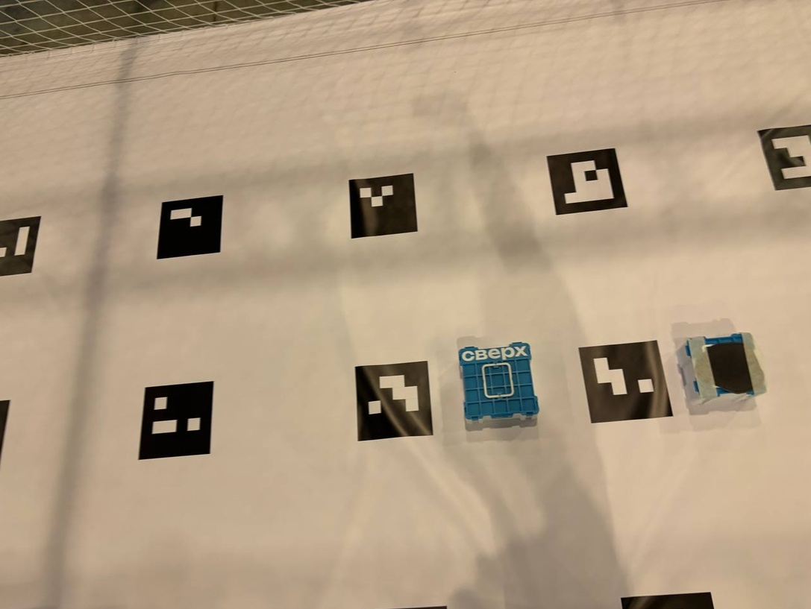
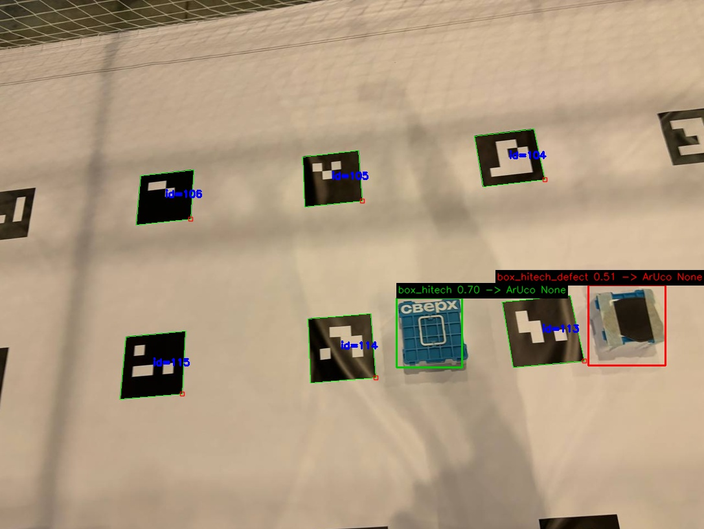
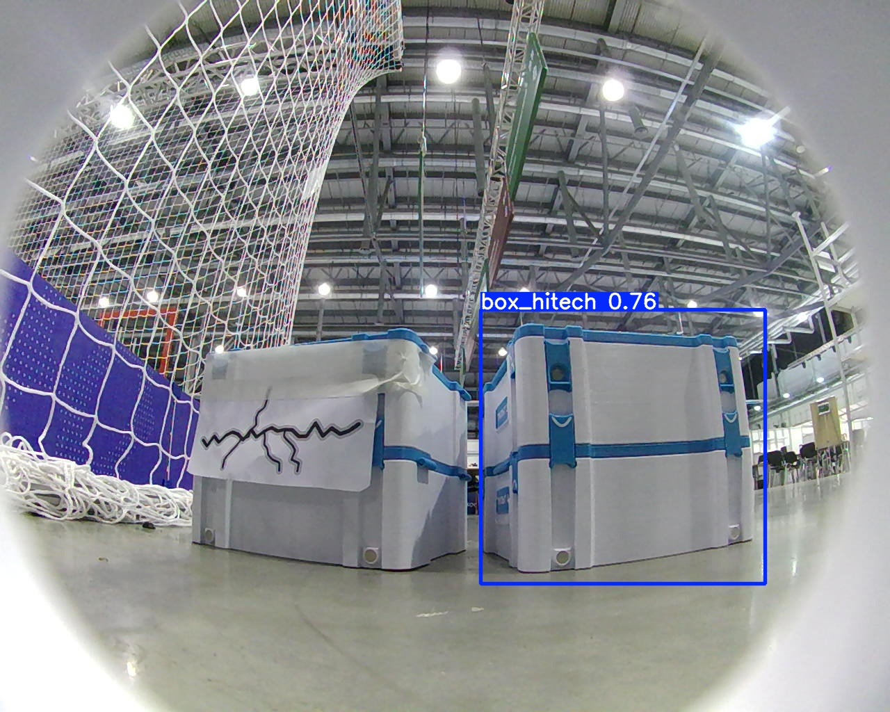
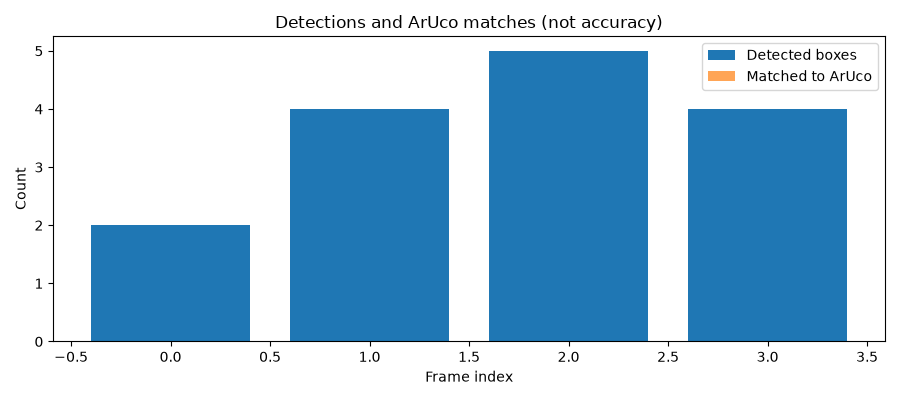

# Инвентаризация площадки хранения · Хайтек 2026

Команда НИЯУ МИФИ. Компетенция «Технологии ИИ в комплексных беспилотных системах».

Рабочая конфигурация — **два дрона, ровер и внешняя станция с YOLO**.
По сообщению команды, дроны автономно пролетели маршруты и распознавали обычные
и дефектные коробки; ровер управлялся вручную через веб-панель и выполнял
распознавание YOLO. Протокол и запись этого испытания необходимо приложить.

**Отдельно реализован автоматический осмотр ровером после посадки дронов.**
Этот режим пока не подтверждён полевым испытанием и не является результатом
описанного выше ручного наземного этапа. Движением управляет код станции,
а не чат ChatGPT.

Для запуска см. [панель](web_station/README.md), для координат —
[привязку карты ровера](rover/README.md), для автоматического режима —
[миссию из гаража](rover/DOCK_MISSION.md).
В текущем `web_station/config.json` автоматический режим включён.
Для повторения испытания с ручным ровером установите
`rover_inspection.enabled: false` в копии конфигурации и передайте её
серверу через `--config ПУТЬ.json`. Само открытие панели не запускает движение.

## 1. Что реализовано

- Станция получает JPEG с двух дронов по HTTP без ручного ввода каждого запроса.
- Модель различает `box_hitech` и `box_hitech_defect`; ArUco определяет адрес места.
- Наблюдения объединяются в ведомость, один ID — одна строка; неосмотренные
  места отделены от оценённых как пустые.
- WebSocket передаёт маршруты двум дронам и получает подтверждения команд.
- Локальный веб-интерфейс показывает подключения, состояние маршрутов,
  ошибки камер, давность кадров, покрытие, ведомость и ссылки на скачивание.
- Одна команда запускает веб-панель и сервер полётных команд. Полёт запускается
  оператором; при включённом автоматическом осмотре общая миссия сама запускает
  CV дронов и очищает предыдущие результаты. Камеры также доступны отдельно.

Это программная интеграция. Успешная попытка на реальной площадке должна
подтверждаться видеозаписью, измерениями и сохранёнными результатами.
**Четыре дрона и гарантированное обнаружение любых повреждений не заявляются.
Автоматический осмотр ровером реализован, но требует отдельной полевой проверки.**

## 2. Основание: история репозитория

| Коммит | Подтверждённый вклад |
|---|---|
| [`79d286e`](https://github.com/smifick/High_Tech_2026/commit/79d286e) | Валидация маршрутов двух дронов, примеры маршрутов, полётный клиент, экономические материалы |
| [`9ff80b1`](https://github.com/smifick/High_Tech_2026/commit/9ff80b1) | HTTP-снимки, двухклассовые веса, сбор с двух камер, покрытие, голосование классов, тесты |
| [`8395e6f`](https://github.com/smifick/High_Tech_2026/commit/8395e6f) | Документ экономической эффективности |

Новая интеграция использует эти компоненты; старая симуляция четырёх дронов
остаётся отдельным экспериментом, не описанием реального состава.
Собственный прикладной код: сопоставление коробок/ArUco, фильтр ложных рамок
на метках, объединение наблюдений, контроль покрытия, маршрутизация, станция.
YOLO/Ultralytics, OpenCV и SDK производителя — внешние зависимости.

## 3. Архитектура и данные

```text
Дрон 1: камера ── HTTP JPEG ──┐
                            ├→ YOLO + ArUco → объединение → CSV / JSON / веб
Дрон 2: камера ── HTTP JPEG ──┘
Дроны ←── WebSocket navigate/land + подтверждения ── станция
Ровер ← HTTP-команды станции (ручной режим / автоматическая миссия)
Ровер: камера → HTTP JPEG → YOLO на станции
```

CV выполняется на внешнем компьютере. Поэтому `scan()` не должен посылать
наблюдения с борта: при включённых камерах веб-панель принимает кадры,
а в режиме CV объединяет результаты в ведомость. После успешных маршрутов
и подтверждённых посадок `flight_and_inspection()` может передать результаты
в `job.json` и запустить навигационную миссию ровера через HTTP/Nav2.
Это обмен через внешнюю станцию, прямого канала между аппаратами нет.
Выполнение полной автоматической цепочки на площадке пока не подтверждено.

Полётный протокол `drone/aruco_nav/ws_control.py`:

```json
{"command":"navigate","params":{"x":2.5,"y":-1.5,"z":2,"yaw":0,"frame_id":"aruco_map"}}
```

Ответ: `{"type":"result","command":"navigate","ok":true}`.
Клиент сначала отправляет строку своего ID, станция отвечает
`{"type":"registered"}`. Это не старый протокол из `shared/ws_server.py`.
Одновременно выполняется одна команда на аппарат. Таймаут закрывает соединение,
чтобы поздний ответ не подтвердил следующую команду. Автоперезапуск маршрута
после потери связи не выполняется. Полётный клиент использует посадку при
завершении соединения, результат требует контроля пилота.

### 3.1. Отдельный прототип общего WebSocket-транспорта

Этот прототип не используется текущей веб-панелью.

**В проекте реализован общий программный слой WebSocket для подключения
дронов и ровера к внешнему вычислителю.** Архитектура — «звезда»: вычислитель
является центральным сервером, а каждый аппарат — адресуемым клиентом.
Это позволяет организовать взаимодействие разных типов аппаратов через один
узел в общей IP-сети, без отдельного сервера для каждого робота.

Реализация подтверждается следующими файлами:

| Компонент | Что реализовано |
|---|---|
| [`shared/ws_server.py`](shared/ws_server.py) | Общий сервер: регистрирует аппараты по уникальному ID, хранит соединения и адресно отправляет сообщения методом `transmit(msg, addr)` |
| [`shared/ws_client.py`](shared/ws_client.py) | Общий клиент: постоянное двустороннее соединение, регистрация, приём JSON-команд, вызов обработчика и ответ `ok/data` либо `ok/error` |
| [`drone/drone_client.py`](drone/drone_client.py) | Клиент дрона на общей базе `WsClient`, с интерфейсами `navigate` и `land` |
| [`rover/rover_client.py`](rover/rover_client.py) | Клиент ровера на той же базе `WsClient`, с интерфейсами `navigate` и `stop`; реальные обработчики передаются при создании объекта |

```text
Дрон 1 ── WebSocket ──┐
Дрон 2 ── WebSocket ──┼── Внешний вычислитель: shared.WsServer
Ровер  ── WebSocket ──┘
          команды → / ← результаты выполнения
```

Протокол общий: клиент отправляет свой ID, сервер подтверждает регистрацию
строкой `ok`; далее передаются JSON с `command` и `params`, а клиент возвращает
результат. Вычислитель различает аппараты по ID и получает ответы по тем же
соединениям. Таким образом, **основа единой сети «ровер — дроны — внешний
вычислитель» уже присутствует в коде**, а не только в проектной схеме.
Для информационного взаимодействия через центральный узел прямое соединение
каждой пары аппаратов не требуется; пересылка конкретных наблюдений между
клиентами при этом должна быть реализована прикладным координатором.

**Проверка транспорта 12.11.2026:** к одному серверу одновременно подключены
`drone1`, `drone2` и `rover1` с использованием существующих классов клиентов.
Каждому адресно отправлена JSON-команда; от всех трёх получен успешный ответ.
Обработчики были тестовыми: эта проверка подтверждает общий транспорт,
адресацию и двусторонний обмен, но не фактический полёт или движение ровера.

**Границы утверждения.** Рабочая панель использует `ws_control.py` для
дронов и `web_station/rover_adapter.py` для штатного HTTP API ровера.
Общий WS-прототип не следует выдавать за действующее подключение всех
аппаратов. Изображения передаются по HTTP. Успешный тест транспорта
не доказывает полевое выполнение автоматической миссии.

## 4. Установка на станции

Python 3.10–3.12, Linux, доступ по сети к камерам и дронам. Для CPU не нужен
MuJoCo и не нужен бортовой `sverk_interfaces`.

```bash
git clone https://github.com/smifick/High_Tech_2026.git
cd High_Tech_2026
python3 -m venv .venv
source .venv/bin/activate
python -m pip install --upgrade pip
python -m pip install torch torchvision --index-url https://download.pytorch.org/whl/cpu
python -m pip install -r requirements.txt
python3 web_station/server.py --help
```

Ultralytics также может установить обычный `opencv-python`. Для ArUco требуется
contrib-вариант; если установленная сборка не имеет `cv2.aruco.ArucoDetector`:

```bash
python -m pip uninstall -y opencv-python opencv-python-headless opencv-contrib-python
python -m pip install --force-reinstall 'opencv-contrib-python-headless>=4.10,<5'
```

Для старых оконных CV-скриптов нужен GUI-вариант OpenCV вместо headless.
`requirements.txt` относится к общему окружению с симуляцией; станцию ставьте
по `requirements.txt`. Бортовой ROS/SDK устанавливается по инструкции
оборудования, а не через pip на ноутбуке.

## 5. Веб-панель и запуск миссии

Единственный веб-интерфейс проекта — **web-station на http://127.0.0.1:8766/**.
Реализация находится в `web_station/`; подробности — в
[инструкции веб-панели](web_station/README.md).

**На ноутбуке, из корня проекта:**

```bash
source .venv/bin/activate
python3 web_station/server.py
```

Панель слушает `127.0.0.1:8766`, встроенный WebSocket-сервер команд —
`0.0.0.0:8000`. Отдельный `drone/aruco_nav/ws_control.py` одновременно
не запускать: он займёт тот же порт. При запуске панели и открытии страницы
моторы не включаются, команды не отправляются, камеры остаются выключенными.

### Подготовка

1. Подключить ноутбук и дроны к общей сети.
2. Проверить `web_station/config.json`: ID `drone3`/`drone4`, соответствие
   адресов камер физическим дронам, пути к маршрутам, карте и весам, словарь
   ArUco и устройство CPU/GPU. Изменить адреса под свою площадку.
3. Проверить локализацию `aruco_map`, ориентацию камер и свободные зоны
   взлёта/посадки. `routes.example.json` — пример, не полевой допуск.
4. В среде производителя запустить существующие клиенты с IP ноутбука:

```bash
# Первый дрон
python3 drone/aruco_nav/ws_flight.py --server ws://IP_НОУТБУКА:8000 --id drone3
# Второй дрон
python3 drone/aruco_nav/ws_flight.py --server ws://IP_НОУТБУКА:8000 --id drone4
```

### Работа оператора

- Открыть **http://127.0.0.1:8766/** и проверить подключения обоих дронов.
- Включить камеры: «Только камера» показывает HTTP-снимки без загрузки модели;
  режим CV включает рамки, классы коробок/дефектов и привязку к ArUco.
- Проверить время последнего снимка и ошибки источников: старый кадр
  не подтверждает, что камера продолжает передавать данные.
- В разделе маршрутов загрузить или отредактировать JSON и запустить общий
  маршрут. Ручная «Отправить цель» задаёт X/Y/Z в `aruco_map` с подтверждением
  координат; первая команда может вызвать встроенный взлёт бортового клиента.
- Следить за выполнением команд, журналом и картой адресов. Ручные команды
  во время общего маршрута заблокированы; повторная команда занятому дрону
  отклоняется.
- «Остановить и посадить» завершает текущие команды и запрашивает посадку.
  Это не мгновенное аварийное прерывание. Дождаться подтверждений и проверить
  физическую посадку с пилотом.
- Скачать «адреса.txt». Для новой инвентаризации остановить камеры и нажать
  «Новый обход». Закрытие вкладки не останавливает маршруты.
- Ctrl+C в терминале завершает камеры и ожидает текущие команды с посадкой;
  при потере связи физическая посадка сервером не гарантируется.

Бортовые клиенты запускаются отдельно при подготовке аппаратуры; панель не
выполняет SSH-развёртывание. Вводить каждую точку маршрута вручную не нужно.
Проверка маршрутов требует ровно два ID и зазор между заданными отрезками
не менее 0.75 м. Она не моделирует встроенный взлёт, переход к первой точке,
ошибку локализации и препятствия. Ручные цели на столкновения не проверяются.

Панель по умолчанию доступна только на ноутбуке. Для другой конфигурации:

```bash
python3 web_station/server.py --port 8766 --robot-port 8001
```

В этом случае клиенты дронов также должны использовать порт 8001.
Параметр `--host 0.0.0.0` открывает панель в локальной сети; пользовательской
аутентификации нет. POST-запросы защищены ключом сессии и проверкой Origin,
но это не замена разграничению доступа между пользователями сети.
WebSocket идентифицирует аппараты по ID. Используйте доверенную сеть оборудования.
Вкладка ровера показывает связь со штатным HTTP API, камеру и ручное управление.
Автоматический наземный этап регулируется `rover_inspection.enabled`.

**Отдельный сборщик распознавания без полётных команд:**

```bash
python YOLO/scripts/scan_two_drones.py \
  --servers 'http://10.11.3.225:8080/snapshot?topic=/camera_1/image_raw' \
            'http://10.11.3.179:8080/snapshot?topic=/camera_1/image_raw' \
  --headless --rounds 10 --save-frames runs/scan_debug
```

## 6. Координаты и привязка

Карта: [`aruco_map_750x450_id100.txt`](drone/aruco_nav/aruco_map_750x450_id100.txt),
45 меток ID 100–144, DICT_4X4_1000. Начало в центре поля, единицы — метры.
Координаты x/y/z для ведомости читаются из карты по ID. Они относятся к центру
метки, а не к измеренному центру коробки. Пиксели не преобразуются напрямую
в полётные координаты. Для контрольных ID: 100 = (−3, −1.5), 122 = (0, 0),
144 = (3, 1.5).

Текущее правило сопоставления: метка над коробкой; `angle_deg=90` в локальных
осях функции. Камеры должны иметь согласованную ориентацию. Параметр `--match-angle`
в отдельном сборщике и отчёте позволяет выбрать 0/90/180/270 после проверки
расположения на кадре. По умолчанию сохранено 90; он не меняет команды полёта. Фильтр исключает
рамки, не менее 50% площади которых перекрывается декодированной ArUco-меткой.
Перекрытый маркер не угадывается; коробка без ID попадает в `unmatched_boxes`.

**Проверка координат на площадке ещё не подтверждена.** Заполнить измерения
в [`docs/coordinate_check.csv`](docs/coordinate_check.csv) и приложить протокол
по [методике](docs/FIELD_CHECK.md). Сейчас это шаблон, а не успешный результат.

## 7. Распознавание и ведомость

Рабочие веса: [`best_for_classificator(2).pt`](YOLO/scripts/best_for_classificator%282%29.pt).
Классы: нормальная коробка и дефектная коробка. Порог 0.25, вход 640, CPU.
Обобщённое распознавание любых аномалий/посторонних предметов не подтверждено.

Снимки запрашиваются параллельно, одна модель обрабатывает их последовательно.
На каждый адрес за кадр берётся один голос наибольшей уверенности. Итоговый
класс — сумма confidence последних девяти наблюдений коробок. Отсутствие рамки
не удаляет найденную ранее коробку. Видимый ID без находок первоначально получает
«пусто»; это может быть ошибкой детекции. Неувиденный ID — «не осмотрено».
После перемещения грузов нужна новая попытка/перезапуск, иначе сохраняется история.

В режиме CV веб-панель сохраняет результаты в `runs/web_station/`:

| Файл | Содержимое |
|---|---|
| `addresses.txt` | Состояния прочитанных мест; доступен кнопкой «Скачать адреса.txt» |
| `addresses.coverage.json` | Покрытие, неизвестные ID, источники, голоса и коробки без ID |
| `inventory.csv` | Все ID карты, состояние, координаты метки и источники; файл на диске |

Журнал команд и ошибок доступен в панели. Новая сессия не загружает предыдущую
инвентаризацию; при включении CV выходные файлы обновляются. Каталоги попыток,
архив кадров и `observations.jsonl` панель автоматически не создаёт.
Для покадрового журнала и сохранения исходных/аннотированных фото используйте
отдельный `scan_two_drones.py` с `--save-frames`, как показано выше.

`complete` означает, что все ID видели, а не что все результаты правильные.
Файлы ведомости обновляются атомарно по отдельности; общий транзакционный
снимок нескольких файлов не гарантируется.

## 8. Отчёт качества

[Покадровый отчёт на сохранённых изображениях](reports/repository_frames/index.html)
содержит пары «исходник / рамки», confidence, ID, CSV и
[график](reports/repository_frames/comparison.png). Для скачанного репозитория
откройте HTML локально; GitHub показывает исходный код HTML.

```bash
python YOLO/scripts/field_report.py \
  --images YOLO/assets/test_match_1.png YOLO/assets/test_mathc_2.png \
           YOLO/assets/test_match_3.jpg YOLO/assets/test_match_4.jpg \
  --output reports/repository_frames
```

Это проверка исполнения модели на имеющихся кадрах, **не независимая оценка
качества на конкурсной площадке**. Происхождение кадров и их отсутствие в обучении
не подтверждены. Без ручной разметки precision/recall не вычисляются.
Для независимой оценки повторить команду с кадрами площадки и `--labels labels.json`
по [методике](docs/FIELD_CHECK.md): отчёт посчитает TP/FP/FN при IoU ≥ 0.5 и P/R.
График количества находок не является графиком точности; mAP этим скриптом
не рассчитывается. Сохранённые кривые обучения в `YOLO/` относятся к своим
запускам, их нельзя автоматически приписывать текущим весам или полевому тесту.

## 9. Проверки ПО

```bash
python -m unittest discover -s YOLO/scripts -p 'test_*.py' -v
python -m unittest discover -s tests -v
python -m unittest discover -s web_station -p 'test_station.py' -v
```

Проверки включают HTTP-снимки, обработку ошибок, геометрию ArUco, слияние двух
источников, сохранение ведомости, интерфейс станции и имитацию полётного протокола.
Тесты не заменяют реальные полёты и не запускают оборудование.

## 10. Сборка и испытания: фактические статусы

| Этап | Подтверждение | Статус |
|---|---|---|
| Датасет и обучение | Ноутбуки, веса и графики в YOLO/ | Артефакты сохранены; независимость полевой оценки не установлена |
| Маршруты двух дронов | `79d286e`, `9ff80b1`, `drone/aruco_nav/` | Код реализован; полевой проход требует протокола |
| Сбор и объединение наблюдений | `9ff80b1`, `scan_two_drones.py` | Код реализован; требуется запись с реальных аппаратов |
| Веб-интерфейс и единый запуск | `web_station/`, порт 8766 | Панель управления, камеры и CV; проверки описаны в docs/VALIDATION.md |
| Пересчёт/локализация на площадке | Шаблон измерений в docs/ | Не подтверждено |
| Независимое качество на площадке | Методика и инструмент отчёта | Требуются кадры и ручная разметка |
| Полный сценарий | Журнал + CSV + запись попытки | Полевое подтверждение не приложено |

## 11. Сроки и доказательства выполнения

| Модуль | Плановый срок (2026) | Что подтверждено |
|---|---|---|
| Подготовка | До 8.11 | Подготовка симулятора MUJOCO для того, чтобы рассчитать оптимальный маршрут детекции всех меток. Также была создана самая первая YOLO для детекции коробок, обученная на фотографиях из интернета|
| Первый полёт, сбор датасета | 9.11 | Коммит flight test от Васильева Матвея |
| Первые модели HSV фильтра и YOLO, а также первый прототип WSClient, скрипты для управления дронов  | 10.11 | Коммиты с моделью finetune, wsserver и  |
| YOLO classificator с распознаванием дефектов, экономическая модель, добавление материалов, используемых при обучении модели| 12.11 | 0e4df82735d8d0868ca2ff02f85c00f1cea9c040 |
В дальнейшем: совершенствование технологии согласно экономическому плану

## 12. Команда

| Участник | Направление |
|---|---|
| Васильев Матвей | Датасет, пилотирование, документация |
| Смирнова Татьяна | Компьютерное зрение, обучение, экономика |
| Мамедов Дмитрий | Программирование, интеграция, руководство |

## 13. Что остаётся для красных критериев

- A1: приложить фактические даты завершения и подтверждения этапов.
- A2: предоставить полевой протокол состава аппаратов и обмена. Прямой автономный
  канал между аппаратами отсутствует; реализован обмен через станцию.
  Его автоматическое выполнение на площадке требует отдельного подтверждения.
- A2: разметить независимые кадры площадки и заполнить измерения координат.
- A3/A4: пройти установку и запуск на целевой технике, сохранить запись и логи.

Критерии с отсутствующими доказательствами не отмечены выполненными.

## 14. Материалы

- [Результаты после обучения модели классификатора](https://drive.google.com/drive/folders/1b3oB2u8srfRB1A5QLkViTTJQDKzbap3d?usp=sharing)
- [Результаты после обучения модели finetune](https://drive.google.com/drive/folders/1f9cjJHpp2opHP6OW4OBjlA1qckjV0ylG?usp=sharing)
- [Результат после обучения baseline модели](https://drive.google.com/drive/folders/1tduDOjbsDDQjkWhqwjAFjiPjvSVqWEFl?usp=sharing)
- [Экономическая эффективность](НИЯУ%20МИФИ_Экономическая%20эффективность.docx).
- [Экономические расчёты](economic/readme.md).
- [Дополнительный документ Google Drive](https://docs.google.com/document/d/1TzZd3jpr0pPZ96yio8IpH1pHM3hNWJbs/edit).
- [Описание сбора с двух камер](YOLO/scripts/TWO_DRONES.md).
- [Оборудование Сверх](https://edu.sverk.tech), [исходный SDK](https://github.com/sverk-tech/sverk-ros2).
- [Обучение классификатора](YOLO/YOLO11n_models/YOLO_model_classificator/README.md).

## 15. Дополнение по последним коммитам · 12.11.2026

Этот раздел добавлен по состоянию на коммит `7a431ac`. Предыдущие разделы
сохранены без изменений и отражают более ранние состояния проекта. В частности,
формулировки о неподключённом адаптере ровера и отсутствии автоматической
передачи задания нужно сопоставлять с обновлениями ниже. Наличие реализации
в коде отдельно от подтверждения её работы в зачётной попытке.

### 15.1. Какие изменения вошли

| Коммит | Дополнение |
|---|---|
| [`7e84cde`](https://github.com/smifick/High_Tech_2026/commit/7e84cde) | Добавлен файл `LICENSE` с текстом GNU AGPL v3 |
| [`0e4df82`](https://github.com/smifick/High_Tech_2026/commit/0e4df82) | HTTP-адаптер ручного управления ровером, камера ровера и режим YOLO в веб-панели; обновлены маршруты и соответствие камер |
| [`24e571f`](https://github.com/smifick/High_Tech_2026/commit/24e571f) | Добавлены ссылки на датасеты дрона и ровера в разделе фотографий |
| [`b052bed`](https://github.com/smifick/High_Tech_2026/commit/b052bed) | Управление ровером с клавиатуры, обработка нестабильной связи, запуск наземного осмотра после завершения полёта, дополнительные проверки |
| [`7a431ac`](https://github.com/smifick/High_Tech_2026/commit/7a431ac) | Объединены изменения веб-панели и документации |

### 15.2. Актуальная веб-панель и подключения

Веб-панель остаётся доступна на **http://127.0.0.1:8766/**:

```bash
python3 web_station/server.py
```

В текущем [`web_station/config.json`](web_station/config.json) заданы:

| Узел | Адрес / настройка |
|---|---|
| Дрон `drone3` | Снимки `http://10.11.3.179:8080/snapshot?topic=/camera_1/image_raw` |
| Дрон `drone4` | Снимки `http://10.11.3.225:8080/snapshot?topic=/camera_1/image_raw` |
| Сервер команд дронам | WebSocket на порту 8000 внешнего вычислителя |
| Ровер | Штатный HTTP API `http://10.11.3.195:8765` |
| Камера ровера | `/api/camera/media/frame?mode=live` на том же HTTP-сервере |

Это адреса текущей конфигурации; перед запуском следует проверить соответствие
физическим аппаратам. В действующей интеграции команды дронов используют
WebSocket, а управление и камера ровера — HTTP. Общая IP-сеть не означает,
что весь трафик передаётся по одному протоколу.

Ручной режим сохраняется: пилот управляет ровером кнопками или физическими
клавишами **W/S** — вперёд/назад, **A/D** — боковой ход для mecanum,
**Q** — поворот направо, **E** — налево, **пробел** — остановка.
Русская раскладка поддерживается; в полях ввода клавиши не управляют моторами.
Отпускание клавиши, потеря фокуса и смена вкладки отменяют движение.

Повторы команд выполняет браузер с паузой 40 мс после ответа. Единичная ошибка
опроса статуса отображается как нестабильная связь; последний успешный статус
считается свежим менее 6 секунд, затем начало движения блокируется.
Штатный watchdog ровера не изменён. Эти механизмы не являются доказательством
успешной полевой проверки остановки при всех видах обрыва связи.

### 15.3. Дополнительный режим «Полёт + осмотр ровером»

В `b052bed` добавлена отдельная программная последовательность
[`flight_and_inspection()`](web_station/server.py):

1. При включённом автоосмотре создаётся новая воздушная ведомость и включаются
   камеры дронов в режиме CV.
2. Выполняются маршруты обоих дронов и ожидаются подтверждения посадок.
3. После успешного завершения формируется `job.json` с ID найденных коробок
   и признаком аномалии. При прерванном полёте наземный осмотр не запускается.
4. Если есть адреса с аномалиями, внешний вычислитель запускает
   `python -m rover.dock_mission run`; для дополнительного осмотра выбираются
   аномальные адреса. Ручное управление через панель блокируется на время
   общей миссии, остановка может прервать осмотр.
5. Задание, журнал и результаты наземного этапа сохраняются отдельно в
   `runs/web_station/inspection-*/`: `job.json`, `mission.log`,
   `result/result.json` и материалы осмотра.

Таким образом, **в коде добавлена автоматическая передача результатов
воздушного распознавания в наземное задание через внешний вычислитель**.
Это расширение ранее описанного транспорта; успешное выполнение всей цепочки
на реальных аппаратах требует отдельного протокола и записи попытки.

**Различие режимов:** ручное управление пилотом и автоматический осмотр —
разные возможности текущего кода. Сейчас в конфигурации установлено
`rover_inspection.enabled: true`. Если выбран сценарий с пилотом без
автоматического наземного этапа, перед запуском общей миссии задают
`false` в отдельной рабочей конфигурации. Это пояснение не меняет настройки
репозитория и не запускает аппараты.

Для автоосмотра используются гараж из
[`rover/dock.field_01.json`](rover/dock.field_01.json), смещение центра коробки
от метки **−0,275 м по X**, карта
`archive/field_01_20261111_125402/map.yaml` и модель
`rover/yolo_two_classes/rover-yolo-two-classes.pt`. Архивная карта запрашивается
через API ровера; одного клонирования GitHub недостаточно для её наличия
на аппаратуре. До выполнения проверяются доступность карты и локализация.
Настройки гаража и смещение относятся к конкретной расстановке, а не к любой
площадке.

**Граница интеграции:** результат наземного осмотра сохраняется отдельным
отчётом. В `flight_and_inspection()` пока нет обратного объединения
`result/result.json` с воздушным `inventory.csv`. Кроме того, обычный просмотр
камеры ровера с YOLO не присваивает коробкам ArUco-ID и не обновляет адресную
ведомость. Эти два режима нельзя считать готовой единой ведомостью с
приоритетом наземного решения.

### 15.4. Иллюстрации на существующих изображениях репозитория

#### Воздушный кадр: исходник и результат обработки

| Исходное изображение | Результат YOLO и ArUco |
|---|---|
|  |  |

На аннотированном кадре показаны обычная коробка (`box_hitech`), дефектная
(`box_hitech_defect`), уверенности и ID распознанных меток. Надпись
`ArUco None` означает, что найденная коробка **не привязалась к адресу**
в этом прогоне. Иллюстрация показывает работу детекции и её ограничение;
она не подтверждает правильную итоговую ведомость.

#### Наземный ракурс: пример обнаружения коробки



Сохранённый пример для наземной модели: правая коробка обнаружена как
`box_hitech` с уверенностью около 0,76; левая дефектная коробка на этом кадре
не выделена. Изображение относится к эксперименту с весами из
`rover/yolo_two_classes/`, а не к доказательству качества всех моделей проекта.
Сопутствующие численные результаты находятся в
[`rover-yolo-two-classes-metrics.json`](rover/yolo_two_classes/rover-yolo-two-classes-metrics.json).

#### Сравнение результатов обработки четырёх кадров



График из сохранённого отчёта сравнивает количество находок и привязок к ID.
Для кадров 0–3 найдено соответственно 2, 4, 5 и 4 коробки, привязок в этом
прогоне нет. Это **не precision, recall или mAP**; независимая ручная разметка
в данном отчёте отсутствует. Подробнее —
[покадровый отчёт](reports/repository_frames/index.html).

### 15.5. Датасеты, лицензия и проверки

- [Раздел фотографий и ссылки на датасеты дрона и ровера](photos_and_videos/photos/README.md).
  Ссылки на Google Drive добавлены в документацию; доступность и содержимое
  внешних папок этим обновлением не проверялись.
- [Лицензия GNU AGPL v3](LICENSE) добавлена отдельным коммитом. Условия
  сторонних библиотек, моделей и датасетов учитываются отдельно; наличие
  `LICENSE` не устанавливает права на все внешние материалы автоматически.
- [Инструкция веб-панели](web_station/README.md) содержит описание ручного
  управления и нового наземного этапа.

При подготовке дополнения выполнены проверки без подключения аппаратуры:

```bash
python -m unittest discover -s web_station -p 'test_*.py' -v
node web_station/test_rover_keyboard.cjs
```

Прошли **17 Python-тестов** и проверка клавиатурного управления в Node.js.
Проверяются имитаторы HTTP/WebSocket, состояния интерфейса, отмена полёта,
управление с клавиатуры и обработка ошибок. Полный автоосмотр на реальной
площадке, корректность координат, повторяемость зачётной попытки и качество
итоговой инвентаризации этими тестами не подтверждаются.
