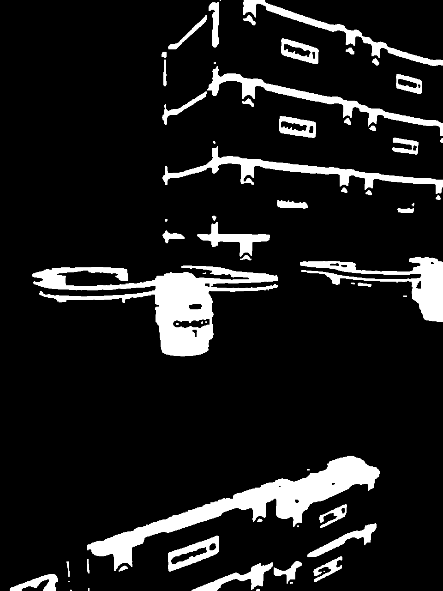
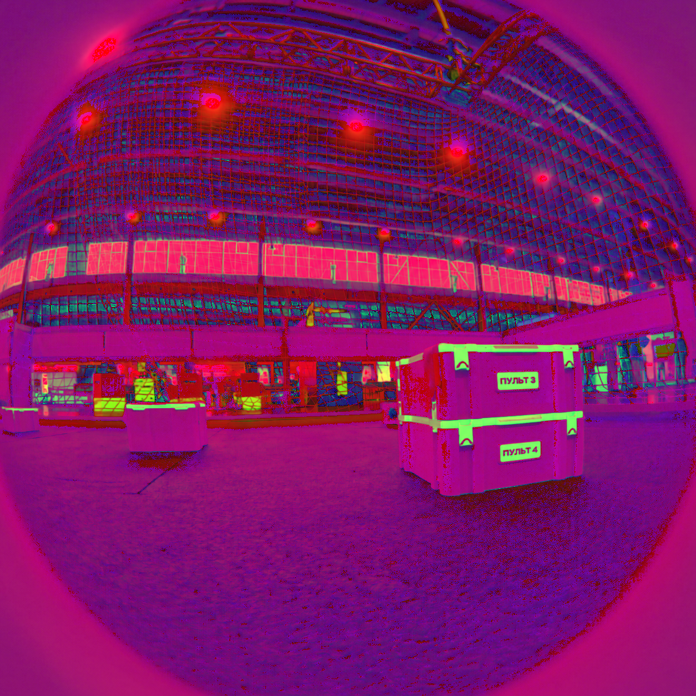

# HSV Color Filter Script

Скрипт для пакетной обработки изображений с фильтрацией по цвету в пространстве HSV.

Скрипт берёт все изображения из папки `assets`, переводит их в HSV, выделяет пиксели в заданном цветовом диапазоне и сохраняет результаты рядом с оригиналами.

## Возможности

- Обрабатывает изображения любого распространённого формата (jpg, png, bmp и т.д.)
- Не зависит от расширения файла — читает содержимое через `cv2.imdecode`
- Пропускает уже обработанные файлы (с суффиксами `__hsv`, `__mask`, `_mask`, `_result`, `_filtered`)
- Применяет морфологические операции (открытие + закрытие) для очистки маски
- Сохраняет:
  - HSV-версию изображения (`имя_файла__hsv.png`)
  - Бинарную маску (`имя_файла__mask.png`)

## Требования

- Python 3.8+
- OpenCV (`opencv-python`)
- NumPy

Установка зависимостей:

```bash
pip install opencv-python numpy
```

## Структура папок

```
project/
├── script.py          # этот скрипт
└── assets/            # папка с исходными изображениями
    ├── photo1.jpg
    ├── photo2.png
    └── ...
```

## Использование

1. Положите изображения в папку `assets` рядом со скриптом.
2. Запустите:

```bash
python script.py
```

Скрипт обработает все подходящие файлы и выведет прогресс в консоль:

```
Готово: photo1.jpg
Готово: photo2.png
Обработано изображений: 2
```

## Параметры фильтрации

Цветовой диапазон задаётся константами в начале файла:

```python
LOWER = np.array([90, 100, 40], dtype=np.uint8)   # H, S, V
UPPER = np.array([110, 255, 255], dtype=np.uint8)
```

Текущие значения ориентированы на синий/голубой цвет (Hue ≈ 90–110).

### Как подобрать свой диапазон

1. Откройте изображение в любом редакторе или используйте `cv2` для просмотра HSV.
2. Измените `LOWER` и `UPPER` под нужный цвет.
3. Перезапустите скрипт.

## Выходные файлы

Для каждого исходного файла `example.jpg` создаются:

| Файл                    | Описание                          |
|-------------------------|-----------------------------------|
| `example.jpg__hsv.png`  | Изображение в пространстве HSV    |
| `example.jpg__mask.png` | Бинарная маска (белый = найденный цвет) |

Исходные файлы **не изменяются**.

## Примечания

- Скрипт игнорирует пустые файлы и файлы, которые не удалось прочитать как изображение.
- Морфология использует ядро 3×3. При необходимости его можно изменить в коде.
- Результаты всегда сохраняются в формате PNG.

## Лицензия

Свободное использование.

## Приложения
Пример обработки изображения после HSV фильтра
Маска HSV


