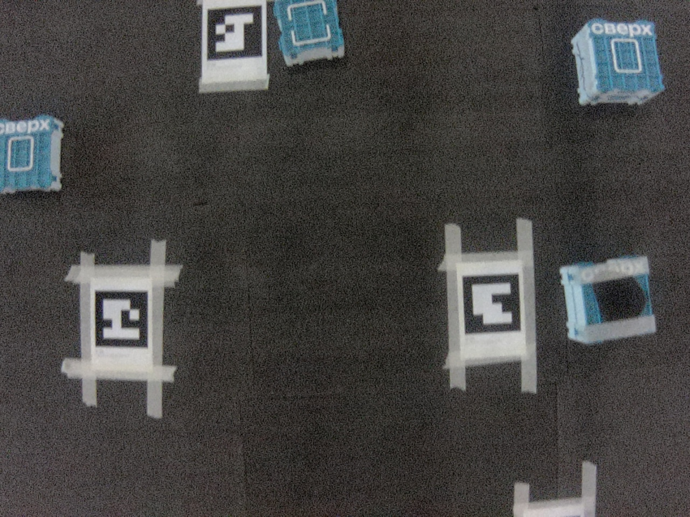

# Полёты на дроне

> Важно: python код выполняется на sverk obric

## Загрузка сетки:
Файл карты `aruco_nav` необходимо перенести в папку `~/sverk_ws/src/sverk_drone/odometry/aruco/aruco_map/config`, далее 
```bash
sudo systemctl restart sverk-ros2-docker.service
```

## Запуск полёта по аруко-сетке:
```bash
python3 drone/aruco_nav/flight_aruco.py
```

## Web socket client
Управление двумя дронами по заданным X/Y-маршрутам в `aruco_map`: [инструкция, формат маршрутов и запуск](../web_station/README.md). Сервер — `aruco_nav/ws_control.py`, бортовой клиент — `aruco_nav/ws_flight.py`.

# Подготовка датасета

В этой папке код для сбора датасета с дрона

> Важно: python код выполняется на sverk obric 


## Одиночный снимок с камеры дрона:
```bash
python3 drone/prepare_dataset/take_picture.py
```
сохраняет jpg снимок в папку photos

## Постоянные снимки с камеры дрона каждую секунду
```bash
python3 drone/prepare_dataset/continuous_take_pictures.py
```
Делает то же самое, но каждую секунду

## Сохранение фотографий с дрона
```bash
scp -r sverk@<ip>:~/photos ./path_on_your_pc
```

## Пример фото:



## Видео в реальном времени для CV

Используется штатный HTTP-сервис камеры дрона; дополнительный `video_sender.py` не нужен.
[Снимки и YOLO на ноутбуке](../YOLO/scripts/VIDEO_BOXES.md),
[обработка двух камер](../YOLO/scripts/TWO_DRONES.md).

Команды выше выполняются из корня копии проекта на дроне с установленным SDK.
Карта: `drone/aruco_nav/aruco_map_750x450_id100.txt`.
