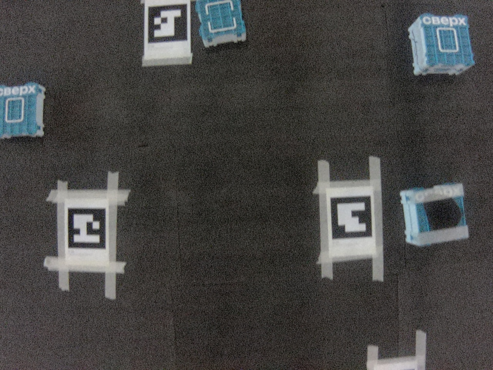

# Подготовка датасета

В этой папке код для сбора датасета с дрона

> Важно: python код выполняется на sverk obric 


## Одиночный снимок с камеры дрона:
```bash
python3 take_pictures.py
```
сохраняет jpg снимок в папку photos

## Постоянные снимки с камеры дрона каждую секунду
```bash
python3 continuous_take_pictures.py
```
Делает то же самое, но каждую секунду

## Сохранение фотографий с дрона
```bash
scp -r sverk@<ip>:~/phtos ./path_on_your_pc
```

## Пример фото:

